# A tour of the web page

What each screen shows and what you can do there. Setting it up is in
[web.md](web.md). The pictures come from `tools/webdemo`, which runs the page
against fake guests with invented numbers; `tools/webdemo --screenshots DIR`
makes them again.

## Logging in

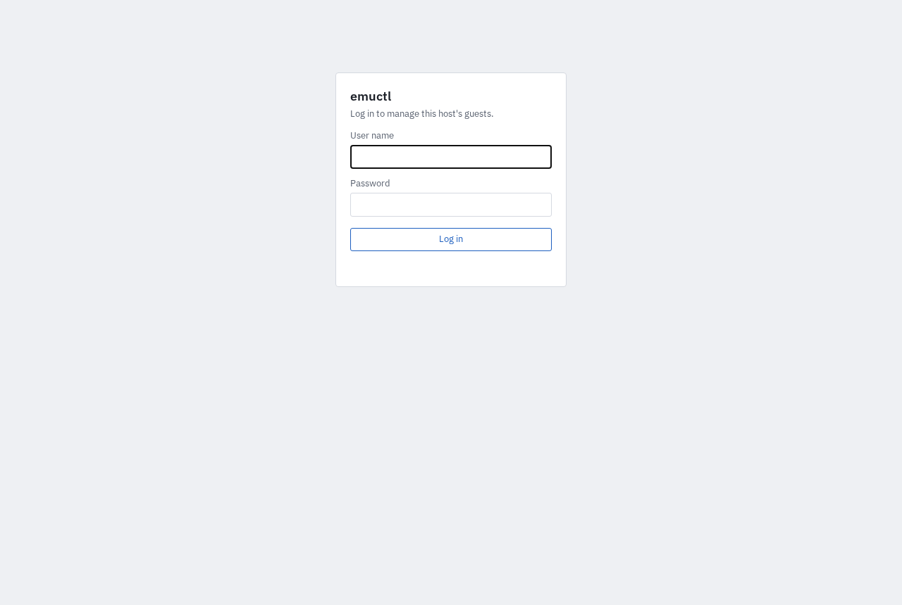

Your user name and password are the ones the admin set with
`emuctl web passwd`. After five wrong passwords from one address the page
makes you wait, doubling the wait each time.

## The layout

Every screen has the same frame:

- **Top bar:** the host's name and emuctl's version, a search box that
  filters the guest list, your name, a switch between light and dark, and
  Log out.
- **Guest list** on the left, with each guest's state. Click the host's
  name for the host, or a guest for that guest.
- **Tasks** along the bottom: the last few things done from the page, by
  whom, and how they ended. Click one to see what the command printed.

The page updates by itself every 5 seconds; there is no need to reload.

## The host

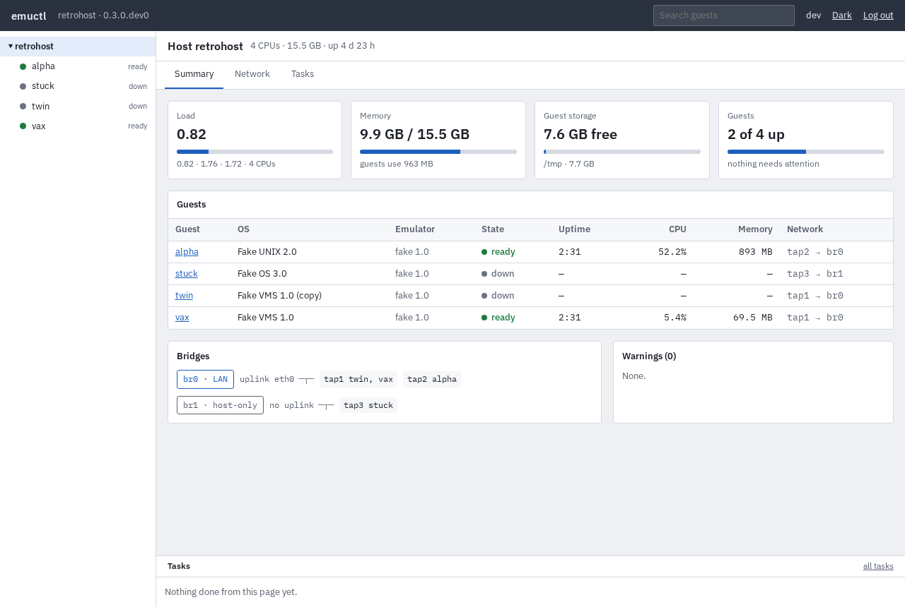

**Summary** shows the host's load, memory, the free space on each
filesystem that holds guests, and how many guests are up. Below that, every
guest with its state, uptime, CPU (as a percentage of one CPU), memory and
which interface and bridge it is on. **Bridges** draws each bridge, whether it
reaches the LAN or is host-only, and the guests behind it. **Warnings** lists
network problems emuctl can see, such as an interface that does not exist or
a guest whose network card has not been seen on its bridge.

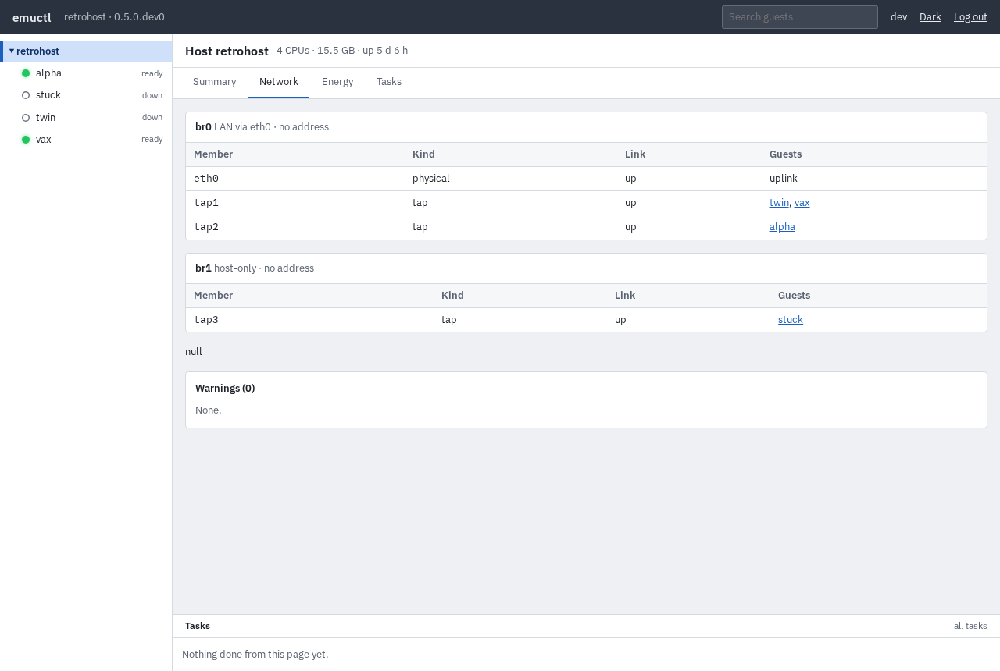

**Network** has each bridge as a table: its members, whether each link is
up, and the guests using it. **Tasks** lists the last 200 tasks.

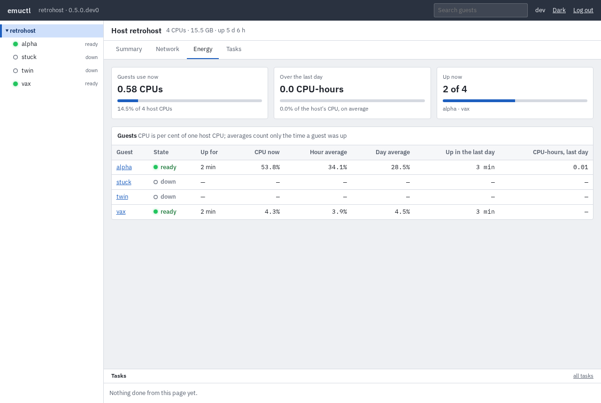

**Energy** shows what each guest costs: how long it has been up, its CPU
now, its average over the last hour and day (counting only the time it was
up), and the CPU-hours it used in the last day. Above, how much of the host's
CPU the guests use now and over the day.

## A guest

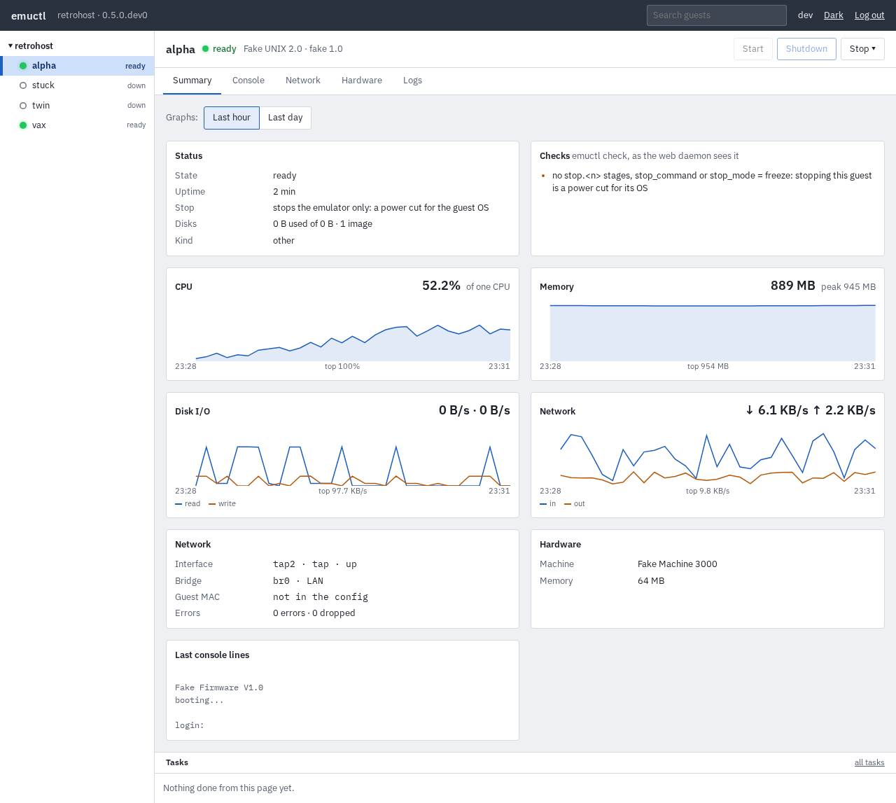

The title bar shows the guest's state, its OS and emulator, and the action
buttons. The tabs are Summary, Console, Display (for a guest with a screen),
Network, Hardware, Logs and Notes (for a guest with a `notes` file).

**Summary** has the guest's state and how it stops, its disk images, graphs
of CPU, memory, disk I/O and network traffic, its network interface, the
hardware read from the emulator's config, and the last lines of its console.
**Graphs** switches between the last hour (a point every 5 seconds) and the
last day (a point a minute). [monitoring.md](monitoring.md) says what each
number means.

Anything `emuctl check` finds wrong with the guest's conf is listed under
**Checks**, as the web daemon's account sees it. A guest with a display has
a **Screen** thumbnail, at most a minute old; click it for the Display tab.
A guest whose conf says `locked = <reason>` is marked "locked", and Start is
greyed out with that reason.

## Starting and stopping

- **Start** starts the guest. When it cannot be started, the button is
  greyed out and holding the pointer over it says why:

  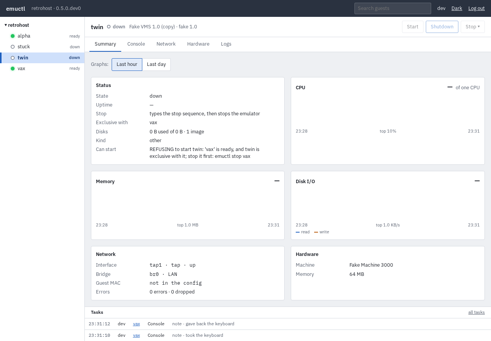

  Here `twin` is `exclusive_with` `vax`, which is running.
- **Shutdown** shuts the guest's OS down the way its conf says, then stops
  the emulator. It is greyed out for a guest with no clean shutdown
  configured.
- **Stop ▾** has two choices that are a power cut for the guest:
  **Stop (force)** stops the emulator without shutting the OS down, and
  **Stop now** skips the guest's shutdown, or cuts one short. Both ask first:

  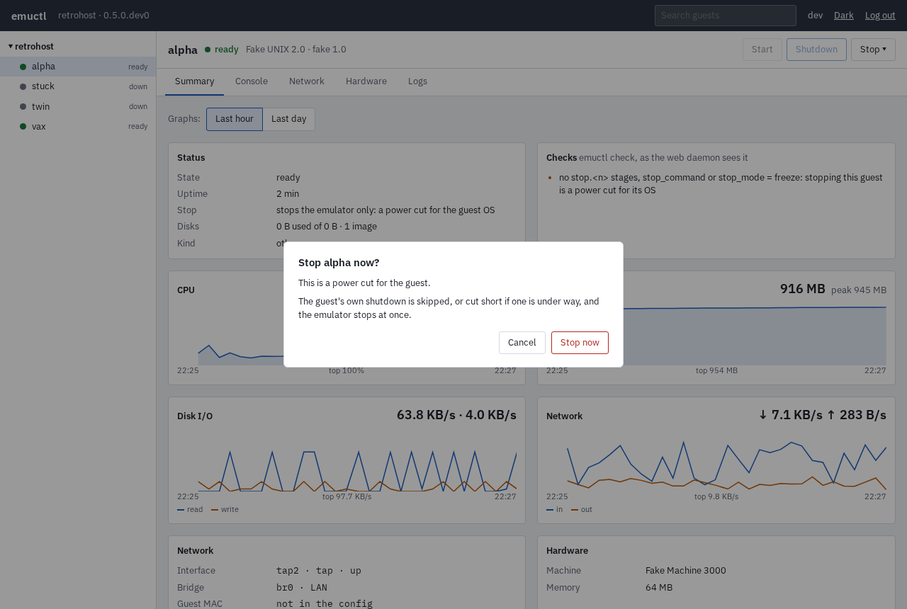

  If the guest's state changes between the page asking and the click
  arriving, so that the stop would now be a power cut you were not asked
  about, nothing is done and the task says so.

Every action becomes a task, with what the `emuctl` command printed. A guest
has one task at a time, except that Stop now can cut short a stop already
running. [stopping.md](stopping.md) explains what each stop does to the guest.

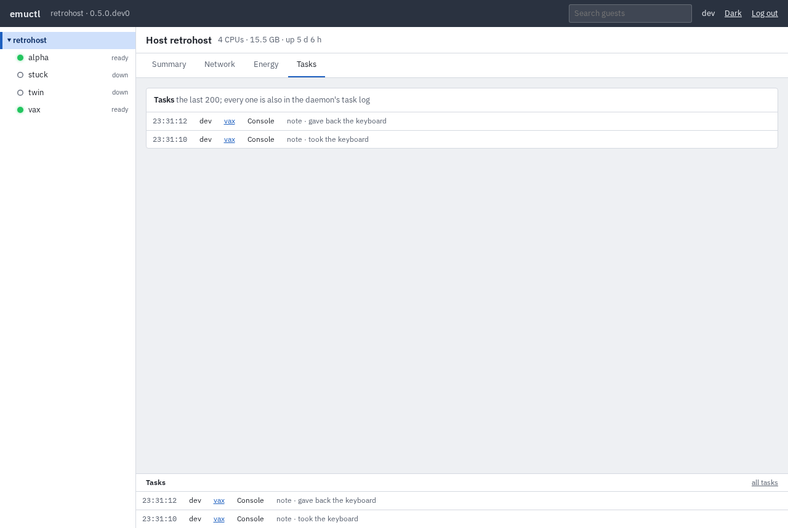

## The console

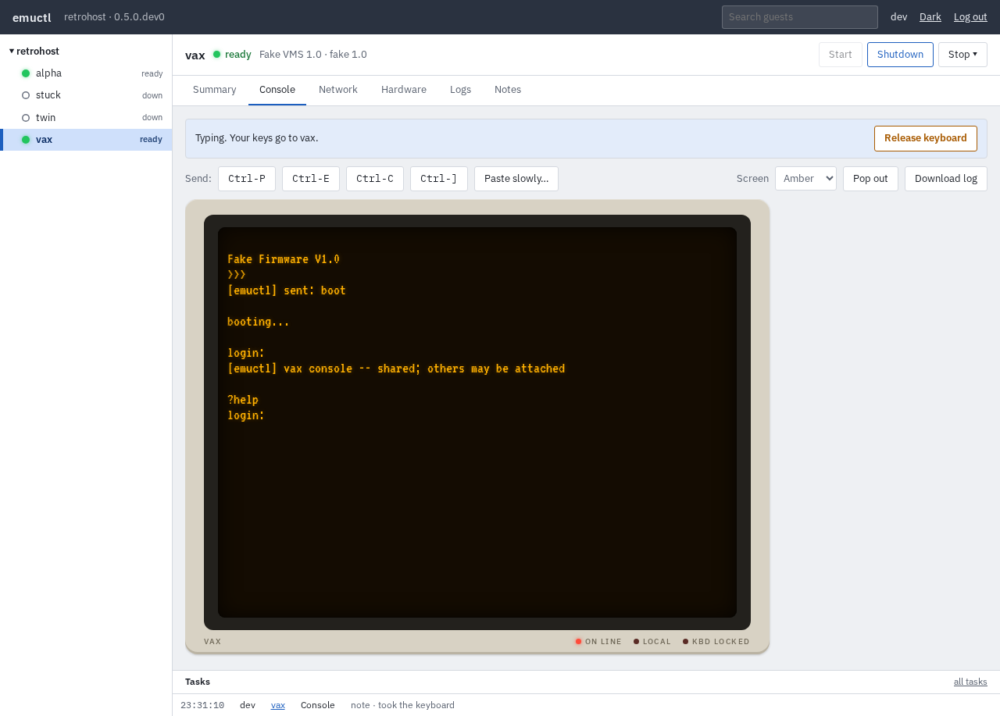

The guest's serial console, shared with `emuctl console` and anyone else
looking. It opens with the last part of the console log, then shows what the
guest prints as it happens.

**Screen** chooses the look, for each guest separately; your browser
remembers it. **Amber**, **Green** and **White** are vintage: an 80 by 24
screen, as the guests' consoles are, in a terminal's case, in a font after
DEC's VT320 that has the line-drawing characters old systems draw forms and
menus with. The lamps under the screen show **ON LINE** while the page is
connected, **LOCAL** when it is not, and **KBD LOCKED** while your keys are
not being sent. On a narrow screen it scrolls sideways rather than shrink
past reading. **Modern** is an ordinary terminal that fills the space, in
full colour, for a guest where the vintage look gets in the way. Until you
choose, a guest gets the default the admin set (`console_look` in
`web.conf`; amber if unset).

- It opens **watching**: what you type is not sent. Press **Take keyboard**
  to type; the banner turns blue and says so. Only one person types at a
  time; taking the keyboard from someone moves it to you, and they see that
  you have it. **Release keyboard** gives it back.
- **Send** buttons type keys a browser would keep for itself: Ctrl-P
  (halts a VAX or Alpha to its console), Ctrl-E (SIMH's own prompt), Ctrl-C
  and Ctrl-].
- **Paste slowly** sends text one character at a time, 20 ms apart by
  default, for old consoles that drop characters typed quickly.
- **Download log** saves the console log.
- **Pop out** opens the console in its own window.

On es40 guests the console sometimes holds back a prompt until the next
key arrives. If you expected a prompt and it has not appeared, press Enter
again.

When you are done, log out of the guest. The console stays logged in after
you close the page, and the next person to open it inherits your session.

## The display

For a guest whose emulator has a VNC server, the **Display** tab shows its
screen. You do not type a VNC password: the daemon logs in for you. Click
the screen to give it the keyboard and mouse. **Scale to fit** sizes the
screen to the window, larger or smaller; **Ctrl-Alt-Del** and **Full screen**
do what they say. A stopped guest's screen shows a note instead.

## Popping a screen out

**Pop out**, on the Console and Display tabs, opens that screen alone in its
own window, with nothing around it, the way Proxmox does. A second click
brings the same window back rather than opening another. Each open display
counts against a login's four, so close windows you are done with.

## Network, Hardware and Logs

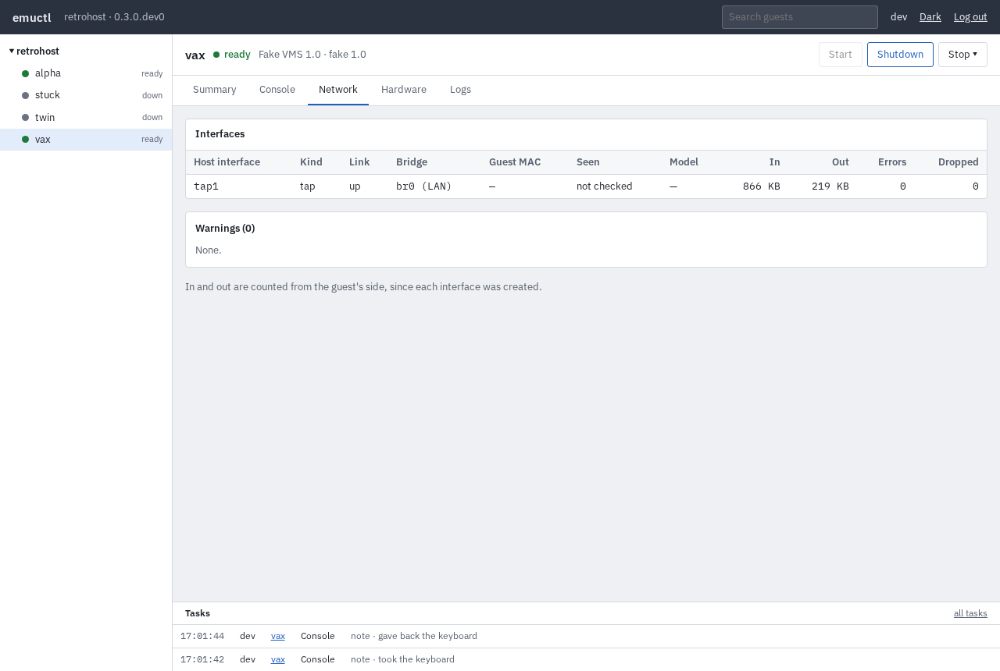

**Network** lists each host interface the guest uses: its kind, whether it
is up, its bridge, the guest's MAC address and whether the bridge has seen
it, and traffic counted from the guest's side. Warnings for the guest are
below.

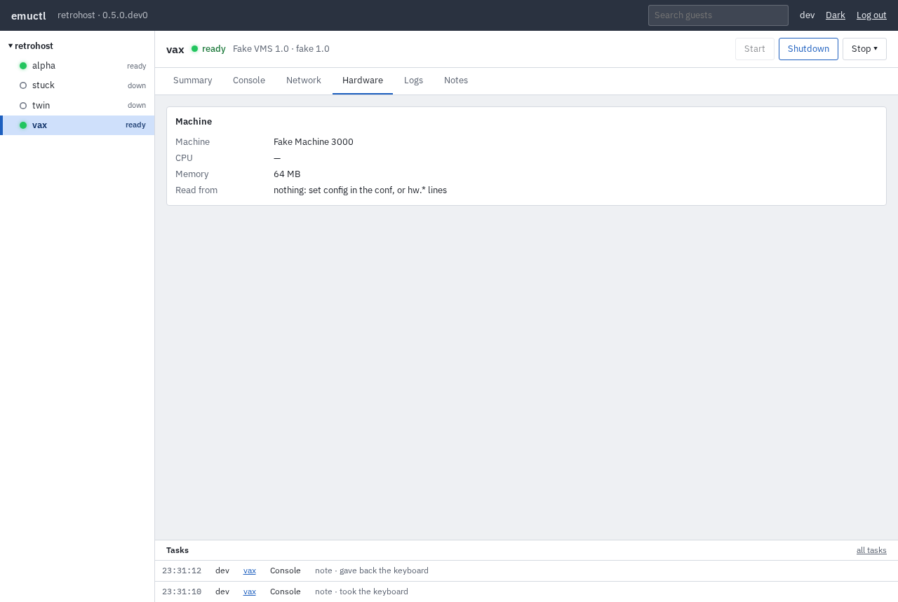

**Hardware** is what emuctl read from the emulator's own config, or from
`hw.` lines in the guest's conf: machine, CPU, memory, disks and network
cards, then each config file as written.

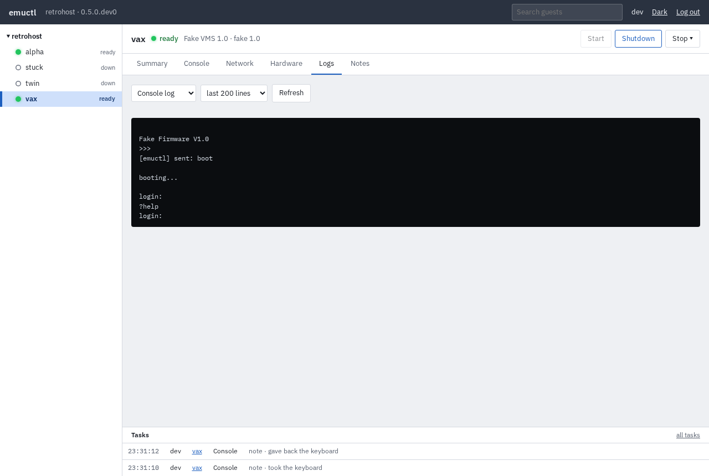

**Logs** shows either the console log or the supervisor's log (what
`emuctl log` shows), the last 100 to 5000 lines.

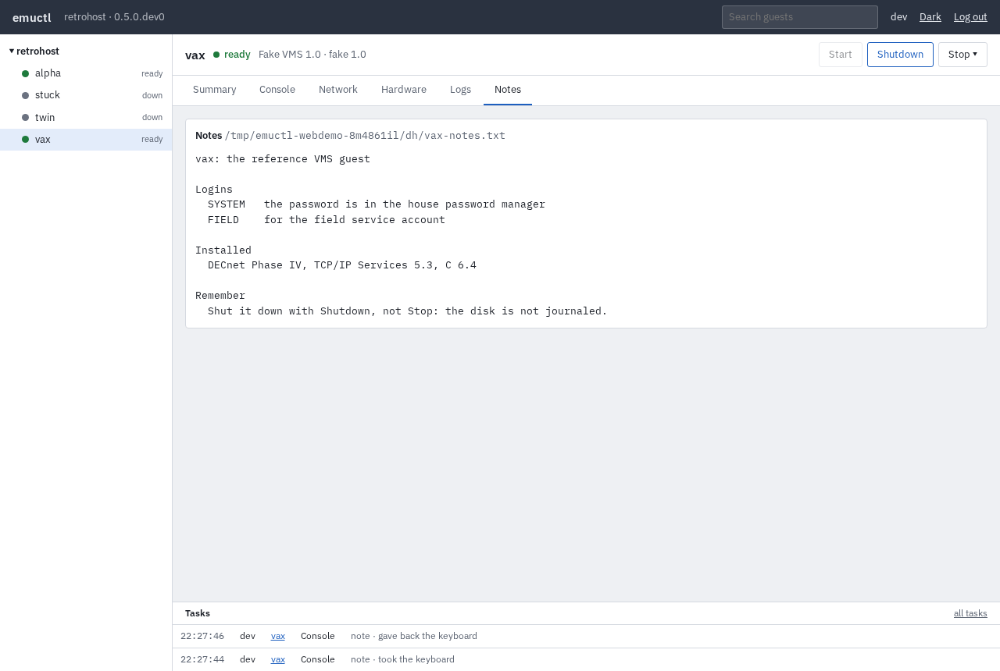

**Notes** shows the text file the guest's conf names with `notes`: how to
log in, what is installed, what to remember. The page only shows it; edit
the file on the host.

## Dark, and on a phone

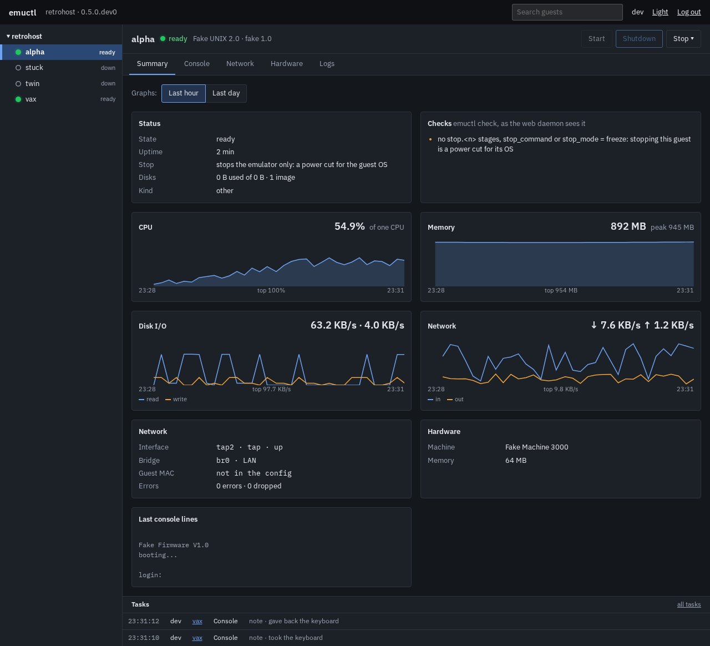

The page follows the browser's light or dark setting; the switch in the top
bar overrides it for that browser. On a phone the guest list folds away
behind **Guests** in the top bar:

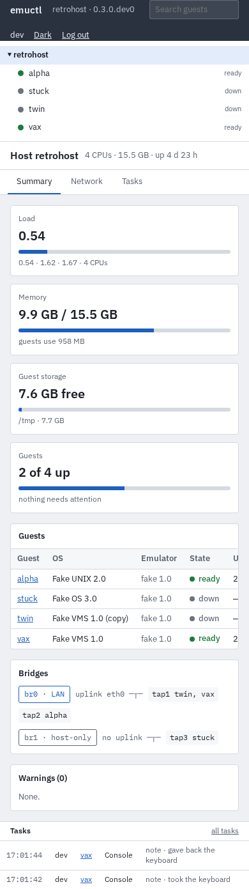
